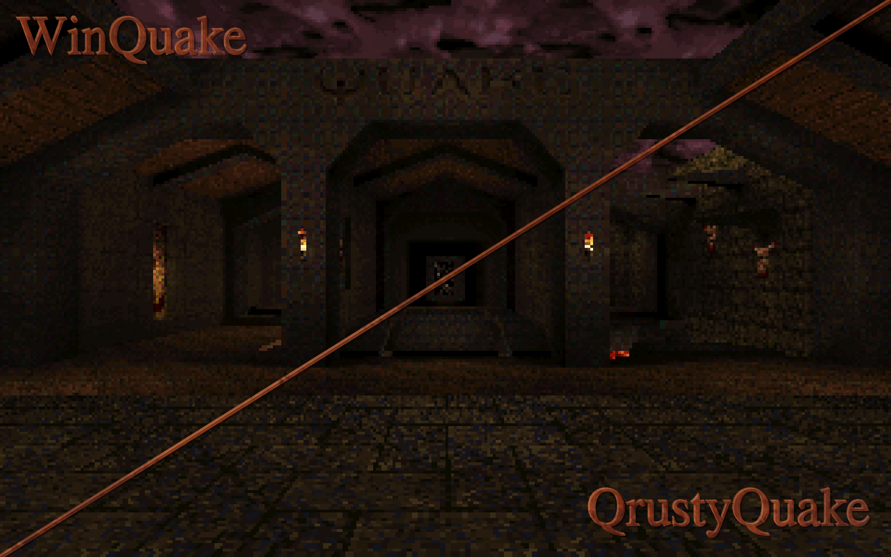
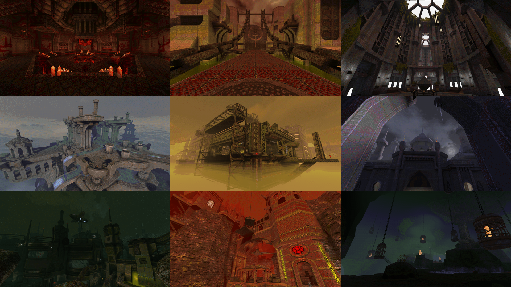

# Qrusty Quake

### Quake like you remember it.

A modernized, SDL3-based WinQuake port aimed at faithfulness to the original and easy portability.

Try it in your browser (requires WebAssembly support): [https://qrustyquake.pages.dev/](https://qrustyquake.pages.dev/)

See the Github [Releases](https://github.com/cyanbun96/qrustyquake/releases) for downloads.

Compatible with most modern mods, check [Compatibility List](https://github.com/cyanbun96/qrustyquake/wiki/Compatibility-List) for details.

Use Github "Issues" tab to report bugs, but check [Known Issues](https://github.com/cyanbun96/qrustyquake/wiki/Known-Issues) list first.

# Features

Almost everything below can be set from the menus, under **Options → Modern Options**. Console names are given in `code` for those who'd rather type.

## Faithful to the original

- Software rendering only, in Quake's 256-color palette, just like DOS Quake and WinQuake. No GPU needed
- With the original game data, the picture matches the original WINQUAKE.EXE almost pixel for pixel, quirks of its hand-written assembly renderer included
- The original look and sound by default: sharp nearest-neighbor scaling, 11025 Hz audio, and 320x200 shown with tall pixels on a 4:3 picture
- All the original menus are kept and work, including "Video Options" and "Use Mouse" in windowed mode. `newoptions 0` hides the "Modern Options" entry for a completely stock Options menu
- Menu background fade: brown DOS (default), dithered WinQuake, dark, or none at all, which is handy while tuning graphics ("Menu BG Style", `scr_menubgstyle`)
- Exit screen: the DOS text screen with its VGA blurbs, the WinQuake one, or a quick exit with no screen at all ("Exit Style", `exitstyle`)

## Display

- Any resolution from 320x200 up to 16K (15360x8640). WinQuake stopped at 1280x1024
- Windowed, borderless or exclusive fullscreen at any mode your monitor supports. Set it in the "Display" menu, on the command line (`-window`, `-borderless`, `-fullscreen`, `-width`, `-height`) or in the console (`vid_setmode <width> <height> <mode>`, where mode is 0 for windowed, 1 for fullscreen, 2 for borderless). The mode is remembered
- Scaling filter, `vid_scalemode`: 0 for sharp nearest neighbor (default), 1 for smooth, 2 for sharp but with softer edges between pixels
- Lower internal resolution with `r_renderscale`: e.g. `r_renderscale 2` and `vid_setmode 320 240 1` play at 320x240 on a 640x480 fullscreen
- Aspect ratio correction ("Aspect Ratio", `aspectr`, 0 for automatic) for non-square pixel modes like 320x200 and 640x400, or any ratio you like. "Lock Aspect" keeps it when the window changes
- Widescreen field of view ("Vertical FOV"): Classic as in the original, Modern for the wider view other modern ports use, or Manual (`yaspectscale`). In Manual, the menu shows the FOV value that gives the same view in other modern ports
- The weapon doesn't get stretched at high FOV (`cl_gun_fovscale`)
- Menus, HUD and console are scaled to the largest size that fits the screen. Pick your own with "UI Scale" (`scr_uiscale`) and keep it with "Lock UI Scale". "UI Width Ratio" (`scr_uixscale`) changes the UI's width on its own
- "Center Menus" (`scr_centermenus`) puts the menus and intermission screens in the middle of the screen
- FPS counter ("FPS Counter", `scr_showfps 1`)
- Higher framerates ("FPS Limit", `host_maxfps`, 0 for no limit). The game itself still updates 72 times a second like the original, only the picture is drawn more often

## Modern effects, in software

All of these are drawn by the software renderer inside the 256-color palette, with color mixing tables and dithering instead of GPU shaders. The **Graphics** menu has three presets: Default (the features modern mods use), Classic (all of them off) and Fancy (Default plus dithered textures, smooth animation, round particles and farther mipmaps).

- Colored lighting from .lit files ("Lighting", `r_rgblighting`) and lit water (`r_litwater`), with a choice of LAB or RGB color matching (`r_labmixpal`)
- Translucent water, slime, lava and teleporters on maps made for it ("Liquids", `r_wateralpha`, `r_slimealpha`, `r_lavaalpha`, `r_telealpha`, or the map's own values). "No VIS" (`r_novis 1`) allows it on any map, at a cost in speed
- Translucent entities and models for mods that use them (`r_entalpha`). "Alpha Style" (`r_alphastyle`) picks how translucency is drawn: Mix (default) blends colors like hardware-accelerated ports do, Dither uses a dither pattern
- Cutout textures for fences, grates and foliage, on walls and on models
- Fog that looks like Ironwail's, set by the map or with QuakeSpasm's `fog` command
  - Dithered between two palette colors for smooth fades ("Dither", `r_fogdither`, on by default). Off uses the single nearest color
  - Brightness (`r_fogbrightness`)
  - Distance from the eye, so the fog doesn't move with the camera ("Distance: Radial", `r_fogdepthcorrection 1`, default). Planar works like QuakeSpasm
  - Turn off "Set By Map" (`r_lockfog 1`) to use your own density and color (`r_lockfogd`, `r_lockfogr`, `r_lockfogg`, `r_lockfogb`), or turn fog off entirely (`r_nofog 1`)
- Skyboxes in TGA, or PNG when built with SDL 3.4 or newer, from the map or with `sky <name>`
  - Sky fog blends the sky into the fog color (`r_skyfog`) and sky noise dithers it (`r_skynoise`)
  - Maps can have several skies, including on moving parts of the level
  - Classic scrolling skies can move smoothly ("Smooth Anim", `r_skysmooth`)
- Half-Life-style water warping ("Liquids → Style: HL", `r_hlwater`), with quality, ripple and wave settings
- Unreal-style dithered texture filtering ("Textures: Dithered", `r_dithertex`): smoother textures up close that keep the pixel look
- Mipmaps rebuilt on map load ("Rebuild Mipmaps", `r_rebuildmips`, Auto by default), which gets rid of stray bright red pixels on dark textures in the distance and pink edges around cutouts. "Mipmap Distance" (`r_mipscale`) sets how far away textures switch to lower detail
- Particles: square or round (`r_particlestyle`), scaled (`r_particlescale`) or a fixed size (`r_particlesize`), and translucent (`r_particlealpha`)
- Strength of the screen flashes for being underwater, taking damage, picking up items and powerups, from 0 to 100: `gl_cshiftpercent`, `gl_cshiftpercent_contents`, `gl_cshiftpercent_damage`, `gl_cshiftpercent_bonus`, `gl_cshiftpercent_powerup`
- Picture adjustments in the "Palette" menu: brightness, gamma, contrast, saturation, vibrance, hue shift, and red, green and blue levels
- Custom palettes: `worldpal <palette> <colormap>` for the world and `uipal <palette>` for the menus and HUD. A mod's gfx/custompalette.lmp and gfx/customcolormap.lmp load automatically, and maps can set their own
- Menus, HUD, console and text are drawn on separate layers, so they keep the standard palette when the world uses a custom one ("Layers")
- `r_showtris 1` or `2` for a wireframe view

## Smooth motion

In the "Graphics → Interpolation" menu:

- Smooth model animation (`r_lerpmodels`) and movement (`r_lerpmove`)
- Smooth weapon recoil (`v_gunkick 2`)
- Smooth light animations (`r_lerplightstyles`): On keeps flickering lights sharp, All smooths every change

## Performance

In the "Graphics → Performance" menu:

- Multithreaded rendering ("Multithreading", `r_threads`). Auto (default) finds the fastest number of threads while you play, and the picture is exactly the same as with one thread
- Skipping parts of the level, models and moving brushes that are hidden behind walls ("World Culling", "Model Culling", "Brush Culling"). Auto (default) uses them only on modern maps, where they help the most

Memory is allocated as needed, so huge maps like The Immortal Lock load without `-heapsize`.

## Sound and music

- Music from files in OGG, Opus, MP3, FLAC, MIDI, MOD or WAV, e.g. music/track02.ogg (needs SDL3_mixer, which is optional when building). Mod folders are searched first, and tracks loop
- `music <name>`, `music_stop`, `music_pause` and `music_resume`, and `-nomusic` to turn music off
- "Keep Music" (`keepmusic 1`) stops the music from restarting on death or reload
- "Sample Rate" (`sndspeed`): 11025 Hz by default for the original muffled sound, or 44100 Hz for clearer sound
- "Pause Sounds" (`snd_allowpause 1`) silences the world while the game is paused

## Controls

- Mouse in menus ("UI Mouse", off by default): left button for Enter, right button for Escape, wheel to change values. "Loud" also plays the menu sound as the cursor moves
- Separate vertical mouse speed ("Y Mouse Speed", `sensitivityyscale`), which applies to gamepads too
- Mouse thumb buttons can be bound
- Gamepad support with its own "Gamepad" menu
  - Pick the controller (several can be connected, and they can be plugged in while playing), or turn it off
  - Deadzone, move and look speed, trigger threshold, axes, and buttons for Enter and Escape
  - A live display of the sticks and triggers
- Held keys and D-pad directions repeat in menus
- "Prev. weapon" in the key bindings menu
- `-vimmode` makes h, j, k and l work as arrow keys

## Console

- Left and Right move the cursor without erasing, Ctrl moves and erases whole words, Ctrl+V pastes, Ctrl+C clears the line
- Hold Ctrl or Shift with PgUp/PgDn to scroll faster, or use the mouse wheel
- Typing a cvar's name shows its current and default values
- Centerprint messages are copied to the console, so they can be read later (`con_logcenterprint`)
- `maps` lists the installed maps with their titles, and `mods` (or `games`) lists installed mods, with descriptions of well-known ones
- `screenshot` saves a BMP of exactly what's on screen, custom palettes and all

## Playing

- "Custom Maps" menu
  - Lists the maps from id1 and from the current mod separately, with their titles
  - Sorts by name, monsters, secrets or date
  - PgUp/PgDn or U/D (AUX1/AUX2 on controllers) to scroll quickly
- "Mods" menu to switch mods without restarting (also `game <name>`)
- Autosaves from Ironwail ("Autosave/Load", `sv_autosave`, `sv_autoload`, `sv_autosave_interval`): saves at a safe moment, not in the middle of a fight, and when you die offers to load it instead of restarting the level
- Delete saves from the Load and Save menus with the Delete key, or with `deletesave <name>`
- `resurrect` brings you back to life where you died, weapons and all (a cheat)
- "Startup Behavior": play the demos (default), or open the menu or the console. Clicking during the demos opens the menu

## HUD

- 10 HUD styles ("HUD Style", `hudstyle 0-9`): Classic, Modern 1 and 2, QuakeWorld, Arcade, Minimalist 1, 2 and 3, Classic without background, and EZQuake
- A choice of crosshairs ("Crosshair", `cl_crosschar`)
- Deathmatch scores on the side of the screen (`scr_sidescore`)
- Custom HUDs from mods that include their own (CSQC), like Arcane Dimensions and Quake Brutalist Jam 3. The "Custom HUD" menu can turn them off (`cl_nocsqc 1`) and set their translucency (`scr_sbaralpha`) and size (`scr_sbarscale`, which the mod decides how to use, and `scr_qchudscale`, which works the same in every mod). These cvars only affect custom HUDs
- Sega Saturn-style animated popup text ("Popup Style", `scr_saturntext`), plus centered notifications ("Notifications", `con_notifycenter`) for the full Saturn look

## Mod and map support

*Maps on the screenshots: mg1 start, mg3 start, qbj3 start, ad_tears, alk_corrupt, ad_azad, ad_tfuma, jam6_ericwtronyn, ino_naitelveni*

- The protocols modern mods and maps need: 666 and 999 (the default), as well as the original 15 (`sv_protocol`).
- Much higher limits than the original:

  | | WinQuake | Qrusty Quake |
  |---|---|---|
  | Resolution | 1280x1024 | 15360x8640 |
  | Entities | 600 | 16384 (`max_edicts`, up to 32000) |
  | Entities on screen | 256 | 16384 |
  | Models | 256 | 4096 |
  | Sounds | 256 | 2048 |
  | Static entities (torches etc.) | 128 | 4096 |
  | Dynamic lights | 32 | 64 |
  | Network message size | 8000 bytes | 65536 bytes |
  | Memory | fixed, set with `-heapsize` | grows as needed |

- BSP2 and 2PSB maps for very large levels, and Quake 64 maps
- The 2021 rerelease and its 2026 update, including Dawn of the Machine: requires the "id1" folder from the KEX version to support mg3 properly
- Maps and mods made on Windows work on Linux and macOS: file names aren't case-sensitive, and Windows-style paths work
- Broken models, textures and maps print a warning instead of crashing, wherever possible

# Planned

- Documentation

- Continuous improvements in modern mod support

- Testing and optimization for more exotic platforms

- Probably not
  
  - Advanced mapping/speedrunning/development features that are not directly related to gameplay (I'm not a mapper, speedrunner or developer)

Contributions of any kind are very welcome. If someone implements their favorite speedrunning cvar or something I'll definitely try to merge it. Issue reports are also greatly appreciated.

# System requirements

Windows (v1.0.2):

- Windows XP or higher

- The 32-bit binary ran on a WinXP VM with 64MB of RAM, which is the minimum required to run the system itself.

- If it can run modern Windows, it can run QrustyQuake

Linux AppImage (v1.0.2):

- Ubuntu 22.04, Debian 12, Fedora 36, RHEL/Rocky/Alma 9 or anything newer

  - Ubuntu 22.04 needs its updates installed. The original 22.04 release won't start

  - Older distros can build from source (see Building)

- Any 64-bit x86 CPU

- PipeWire and JACK libraries, even if you use neither for sound

  - Most desktops have them. If the game says "libjack.so.0" or "libpipewire-0.3.so.0" is missing, install:

    - Debian/Ubuntu: `libjack-jackd2-0` and `libpipewire-0.3-0`

    - Fedora/RHEL: `pipewire-jack-audio-connection-kit-libs` and `pipewire-libs`

    - Arch: `pipewire-jack` (or `jack2`) and `libpipewire`

- If the AppImage doesn't open, install fuse3 or run it with --appimage-extract-and-run

# Building

Linux: cd src && make -j$(nproc)

Windows and BSDs: cmake -B build -DCMAKE_BUILD_TYPE=Release && cd build && cmake --build . --parallel

Linux release AppImage is built with AppImage/build.sh

Use Build_SteamOS.sh for Steam Deck

Build requirements (v1.0.2):

- A C99 compiler. GCC 5 or newer works with the Makefile as is

  - GCC 4.8: make RELEASE_FLAGS="-O3 -flto -g -std=gnu99"

- SDL 3.2.0 or newer

- SDL3_mixer 3.2.0 or newer for music, which needs SDL 3.4.0 or newer. Without it the Makefile builds without music

- CMake 3.16 or newer to build SDL3 and SDL3_mixer from source, 3.22 or newer for the CMake build of the game

- Ubuntu 20.04 and Debian 11 are the oldest distros whose own CMake can build SDL3. With a newer CMake from cmake.org it builds back to Ubuntu 14.04 and CentOS 7

  - Ubuntu 14.04: configure SDL with -DSDL_X11_XINPUT=OFF, or the game hangs when its window opens (a libXi bug)

# Successful builds

| Platform | CPU | Tested on | Version | Notes |
|:--|:--|:--|:-:|:--|
| **Arch Linux** | x86_64 | Hardware | 1.0.2 | The main platform this port is developed on, so the most likely to work. Built with GCC, Clang and TinyCC |
| **Ubuntu 14.04** | x86_64 | Docker | 1.0.2 | The oldest distro tested. GCC 4.8, with SDL3 and SDL3_mixer built from source using CMake from cmake.org. See [Building](#building) for the GCC 4.8 make command and the SDL option it needs |
| **Linux AppImage** | x86_64 | Docker | 1.0.2 | Starts on Ubuntu 22.04, Debian 12, Fedora 36, Rocky 9 and newer. See [System requirements](#system-requirements) |
| **Linux AppImage** | AArch64 | QEMU (Debian 12) | 1.0.2 | Plays with sound in an emulated VM, too slow there to judge speed. Not tried on real ARM hardware yet |
| **Ubuntu** | RISC-V | MangoPi MQ Pro | 0.8.1 | `timedemo demo1` at 320x200 with all graphics layers set to 0 gets 17 fps |
| **SteamOS** | x86_64 | Steam Deck | 0.8.2 | [`Build_SteamOS.sh`](Build_SteamOS.sh) script by Pup Luka |
| **FreeBSD** | x86_64 | Hardware | 1.0.2 | Seemingly perfect |
| **OpenBSD** | x86_64 | Hardware | 1.0.2 | Seemingly perfect |
| **HaikuOS** | x86_64 | Hardware | 1.0.2 | Seemingly perfect. SDL3_mixer has no Haiku package, so build it from source |
| **macOS** | x86_64 | Hardware | 0.6.2 | 14.6.1: CMake build with SDL3 from Homebrew, without SDL3_mixer. 15.7.2: Makefile build with SDL3 from Homebrew, mixer not tested |
| **Windows** | x86_64 | Hardware, VirtualBox | 1.0.2 | Also runs under Wine, and on Android through Winlator: set "DX Wrapper" to "CNC DDraw" if you get a "No outputs found" error |
| **Windows XP** | i686 | VirtualBox | 1.0.2 | Ran with 64 MB of RAM. Cross-built with MinGW, see [`cmake/README-winxp.md`](cmake/README-winxp.md) |
| **DOS** | x86 | FreeDOS (QEMU), DOSBox | 1.0.2 | Built with DJGPP by [`dos/build-dos.sh`](dos/build-dos.sh). `timedemo` against QUAKE.EXE 1.06: 920 vs 680 fps in FreeDOS, 95 vs 112 in DOSBox. In DOSBox, sound stutters below about 25 fps and 1024 or 1280 wide modes stay black |
| **Android APK** | AArch64 | Redmi 9 (LineageOS 20) | 1.0.2 | No built-in touch controls, an external input device is required. Tested with GKME in its "Local (Shizuku)" mode (a virtual on-screen controller). The game data goes in `qrustyquake/id1` in the phone's storage. `timedemo demo1` gets 233 fps at 320x240 |
| **Android Termux** | AArch64 | Hardware | 1.0.2 | Ran through X11 with touch controls. *Unpleasant*. |
| **Web (Emscripten)** | WebAssembly | Browsers | 1.0.2 | Dark magic performed by Erysdren, please don't ask me about it. CMakeLists updated by Pup Luka (since commit 5b68511) |

GitHub Actions builds Windows, both Linux AppImages, DOS and the Android APK on every push.

# Credits

This port started out as a fork of https://github.com/atsb/sdlwinquake

Which was a fork of another fork. It's forks all the way down...

It has since evolved into the wonderfully unhinged NakedWinQuake https://github.com/atsb/NakedWinQuake

Atsb has also contributed some crucial fixes to long-standing issues and some general improvements.

Some code, including VGA text blurbs, has been taken from https://github.com/erysdren/sdl3quake/

Big thanks to Erysdren for contributing quite a lot to the backend and makefiles to make compilation on exotic systems possible, implementing BGM, mipmap regeneration, BMP screenshots, and lots of other cool stuff.

Izhido heroically made the native windows build possible, and in the process brought the Windows version to the same feature level as the others.

The FitzQuake protocol implementation, both client and server, sound system, model loading, filesystem functions, cvars and a whole lot more has been pulled directly from QuakeSpasm.

A lot of code is adapted from Ironwail. Most of the netcode is a direct copy, other chunks are adapted with minor changes. QCVM/CSQC code is mostly taken from IW too. Also the autosave system has been practically copy-pasted from Ironwail.

TGA image loading code taken from MarkV, same for alias model lerping, along with lots of other software rendering code. Some of it comes from ToChriS engine by Vic.

Bubbleguuum's build system is used for release AppImages. Bubbleguuum has also contributed several miscellaneous fixes. 

Pup Luka has contributed the "resurrect" command, r_showtris, faithful Saturn text, svc_sellscreen, WinQuake-style exit screen, Steam Deck build script, and a lot of miscellaneous fixes all over.

Several LLMs (notably Claude) have been used during development for various purposes, mostly optimization and miscellaneous bug fixes.

--CyanBun96 <3
